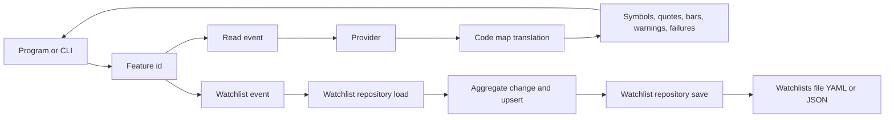

# Core Domain Distillation - Tiferet Stocks

**Status:** Draft (pre-implementation) - **Domain:** `tiferet-stocks` - **Code:** none yet
**Companion:** `docs/domain-vision.md`

> Pre-implementation note: the tiferet-stocks repository holds only a README, a license and a .gitignore. Every behavior below is the PLANNED shape, not existing code. Framework citations point at greatstrength/tiferet main at 4896542 (package version 2.2.0), as the patterns this domain follows; all paths in citations are paths in that repository. No paths in the target repository are cited, because none exist.

## 1. Purpose of this document

The vision statement says what Tiferet Stocks is for. This document says how it is meant to work: its vocabulary, its bounded steps, the rules between its parts, and the seams where the design bends.

The whole package is one core domain. Read this before writing an RFP, before judging whether a feature belongs here, in tiferet-ledger or in tiferet core, and before adding a provider or an exchange. When code lands, cite it and record drift.

## 2. The core domain, restated precisely

Tiferet Stocks' core domain is **answering what a symbol is and what it is worth, in the library's own provider-neutral vocabulary, from a market data provider chosen in configuration, and keeping named, ordered watchlists of symbol ids**.

Three rules shape everything else. First, the domain is read-only except for watchlists: quotes, history, symbol lookups and the exchange list are returned to the caller and never written, cached to disk or stored. Second, provider vocabulary stops at the provider: the provider's exchange and instrument codes are translated into domain ids before any domain object is built, and no domain object carries a raw provider code. Third, nothing requested is silently dropped: every symbol a caller asks about comes back as a result or as a named failure.

The domain has two fixed shapes:

> **Read:** request -> **fetch** from the provider -> **translate** provider codes -> **answer** with results, warnings and failures

> **Watchlist change:** load -> **change** on the aggregate -> **stamp** the change time -> **save** the whole watchlists file

It has four axes of variation:

1. **Market data provider** - where quotes, daily history and symbol details come from. The Yahoo chart provider is the configured default; a static provider serves tests; further providers (a second public source, a paid feed) are later additions. Each brings its own endpoint, failure modes and code maps.
2. **Listing vocabulary** - the set of exchange ids and asset types the domain recognizes, and each provider's map onto them. In v1 the exchanges are NYSE, NASDAQ, NYSE_ARCA, CBOE_BZX and NYSE_AMERICAN, and the asset types are equity, etf, mutual_fund and money_market_fund.
3. **Watchlist file format** - YAML or JSON, chosen by the file extension. The starter file is YAML.
4. **Caller surface** - a program calling a feature directly, or the CLI.

Everything else is identical across the axes.

## 3. Ubiquitous language

**Domain object** - a pydantic model holding validated, read-only state, with strict fields and validation on assignment (`DomainObject`, `tiferet/domain/core.py:218`; its config at `tiferet/domain/core.py (230-236)`).

**Aggregate** - the mutable counterpart of a domain object, the only form a change is applied to; `set_attribute` honors an allow-list named `_SETTABLE_ATTRIBUTES` (`tiferet/mappers/core.py:17`, `tiferet/mappers/core.py (27-65)`).

**Transfer object** - the format-facing form of a domain object, serialized through named **roles** such as `to_model` and `to_data`, and mapped to an aggregate with `map` (`TransferObject`, `tiferet/mappers/core.py:95`; `to_primitive` at `tiferet/mappers/core.py:120`; `map` at `tiferet/mappers/core.py:146`). A **config object** is a transfer object for a stored record.

**Service** - an abstract contract an event depends on (`tiferet/interfaces/core.py:136`). A **provider** is a concrete service that talks to a market data source. A **repository** is a service that reads and writes a configuration file (`ConfigurationRepository`, `tiferet/repos/core.py:21`).

**Event** - one single-purpose operation (`DomainEvent`, `tiferet/events/core.py:17`). A **feature** is a declared, ordered list of event steps, run by a feature id such as `error.add` (`tiferet/assets/feature.py:59`).

**Catalogued error** - a named domain failure resolved to a configured message, raised as `TiferetError` (`tiferet/assets/core.py:596`), usually through an event's `verify` (`tiferet/events/core.py:54`). Distinct from a **model error**, a defect inside one model that is deliberately never catalogued (`ModelError`, `tiferet/domain/core.py:87`), and a **service error**, an infrastructure failure that is also never catalogued (`ServiceError`, `tiferet/interfaces/core.py:15`).

**Symbol** - the domain object for one tradable or quotable instrument: id (the ticker, such as AAPL), exchange (optional), name, asset type and currency (default USD). There is no CUSIP field.

**Ticker** - the symbol's id. Tickers are unique per exchange; the bare ticker is the v1 key, and a qualified key such as `NASDAQ:AAPL` is a possible future extension only.

**Exchange id** - one value from `EXCHANGES`, the module-level list in the symbol module: NYSE, NASDAQ, NYSE_ARCA, CBOE_BZX, NYSE_AMERICAN. A symbol has at most one. The constraint is a `Literal` built from the list, the same way core builds choices at `tiferet/domain/feature.py:144`.

**Asset type** - one value from `ASSET_TYPES`: equity, etf, mutual_fund, money_market_fund. An **ETF** is a Symbol whose asset type is etf; there is no separate ETF object. A **fund** here means a mutual fund or money market fund; funds have no exchange by rule.

**Provider code** - a provider's own label for an exchange or instrument type, such as Yahoo's NYQ or EQUITY. Provider codes exist only inside the provider.

**Code map** - a provider's translation from provider codes to exchange ids or asset types.

**Symbol warning** - a soft notice attached to a result (symbol id, reason, detail). The reason `unmapped_exchange` means the provider code had no entry in the code map; its detail carries the raw code. The symbol is still returned.

**Quote** - the latest price for a symbol id: price, previous close and change percent (both optional), market time, currency and source provider id.

**Price bar** - one day of history for a symbol id: date, open, high, low, close, and optional adjusted close and volume.

**Quote failure** - a named reason a symbol produced no result: not_found, http_error, timeout or bad_payload, with detail and the number of attempts.

**Quote set** - one quote call's answer: quotes by symbol id, symbols filled from the same response, warnings, failures and the fetch time.

**Symbol lookup** - one lookup call's answer: symbols by id, warnings and failures.

**Watchlist** - a named, ordered list of symbol ids: id, name, optional description, `created_at`, `updated_at` and `symbol_ids`. It holds ids only, each at most once.

**Watchlists file** - the one configuration file holding every watchlist under a `watchlists` node, keyed by watchlist id. It is the only thing the domain writes.

**Index** - a 0-based position in `symbol_ids`. -1 means the end and is the default; a position past the end also means the end; -2 or lower is an error.

**Upsert** - the aggregate step that stamps a change: it sets `updated_at`, and sets `created_at` too when it is still empty. Both are ISO 8601 strings with a UTC offset.

**CLI** - the package's command line, built on core's CLI blueprint (`build_app`, `tiferet/blueprints/cli.py:359`).

## 4. What the domain reads / operates on

The domain operates on four inputs.

**Requests**: a feature id plus its data, from a program or the CLI. Read requests name one or more tickers, and optionally an expected exchange per ticker or a date range. Change requests name one watchlist and one operation.

**Provider responses**: the source's answer per ticker. The Yahoo chart response carries currency, an exchange code, an instrument type and names in its metadata, and prices in its series. Responses are read once per call and discarded.

**The watchlists file**: YAML or JSON, read through `ConfigurationRepository._load` with a start node (`tiferet/repos/core.py:87`) and written whole through `_save` (`tiferet/repos/core.py:109`). The loader is chosen by extension: `.yaml` or `.yml` gets the YAML loader and `.json` the JSON loader (`tiferet/repos/core.py (57-84)`).

**Configuration**: the services, features, errors and CLI commands that wire the package. The provider is one service entry.

Four core conventions give the domain its leverage. The id is the configuration key and is left out of the stored body (`'exclude': {'id'}` at `tiferet/mappers/error.py:116`), so a watchlist's id is its key in the file. A repository reads one node and saves the whole file, as the error repository does (`tiferet/repos/error.py (116-125)`). An aggregate changes a list by copying, changing and reassigning it so validation runs (`tiferet/mappers/app.py:69`, `tiferet/mappers/app.py (89-93)`). Allowed values are a `Literal` built from a list (`tiferet/domain/feature.py:144`).

## 5. The behaviors

### 5.1 Symbol lookup and resolve

*Ask the provider what each ticker is, and check the answer against what the caller expected.*

Planned events: `GetSymbol` for one ticker and `ResolveSymbols` for many (for example a watchlist's `symbol_ids`), both on the symbol lookup service, plus `ListExchanges`, which returns `EXCHANGES`. ResolveSymbols compares each result with the requested ticker and with an expected exchange when the caller supplies one, and reports a mismatch or an unresolved ticker as a failure. Nothing is stored or overwritten.

Verdict: **agnostic** in pipeline; **variable** on axis 1 (who answers) and axis 2 (which ids are possible).

### 5.2 Translation of provider codes

*Turn provider codes into exchange ids and asset types before any domain object is built.*

This lives inside the provider, not the domain. The Yahoo code map is: NYQ to NYSE; NMS, NGM and NCM to NASDAQ; PCX to NYSE_ARCA; BTS to CBOE_BZX; ASE to NYSE_AMERICAN. Instrument types map EQUITY to equity, ETF to etf, MONEYMARKET to money_market_fund and MUTUALFUND to mutual_fund; the MUTUALFUND label is expected but has not been observed live. Funds get an empty exchange by rule and no warning, even when the provider reports a code (Yahoo labels a money market fund NAS). Any other unmapped exchange code leaves the exchange empty and adds an `unmapped_exchange` warning carrying the raw code; it is never an error. An unmapped instrument type leaves the asset type empty with a warning. The mapped values are fed to a provider transfer object that inherits the Symbol fields, so an untranslated code cannot validate into it.

Verdict: **variable** on axes 1 and 2; this is the edge of the domain by design.

### 5.3 Current quotes

*Return the latest quote for each requested ticker, with every miss named.*

Planned event: `GetQuotes` on the price service. The default provider tries each ticker, retries once on failure, and records a quote or a quote failure; endpoint URLs, timeout and retry count are provider parameters that configuration can override. The event raises the catalogued error QUOTES_UNAVAILABLE only when every ticker fails; partial failure is data, not an exception. Symbols in the same response are filled into the quote set.

Verdict: **agnostic** in pipeline and failure reporting; **variable** on axis 1.

### 5.4 Daily price history

*Return daily price bars for one ticker between two inclusive ISO dates, oldest first.*

Planned event: `GetHistory` on the price service, in v1. The default provider uses the same chart endpoint with a daily interval. It takes a single symbol: when the provider fails for that symbol (not found, a request error or a malformed payload) it raises the catalogued `HISTORY_UNAVAILABLE`, and a valid date range with no trading days returns an empty list. It stores nothing.

Verdict: **agnostic** in pipeline; **variable** on axis 1.

### 5.5 Watchlist reads

*Return one watchlist by id, or all of them.*

Planned events: `GetWatchlist`, which raises WATCHLIST_NOT_FOUND for an unknown id, and `ListWatchlists`, on the watchlist service. Reads never change timestamps and leave the file untouched.

Verdict: **agnostic**; **variable** only on axis 3, inside the repository.

### 5.6 Watchlist changes

*Create, update, delete a watchlist, or add, remove or move one of its symbols.*

Planned events: `CreateWatchlist` (WATCHLIST_EXISTS for a taken id, WATCHLIST_SYMBOL_EXISTS for repeated initial ids), `UpdateWatchlist` (name and description; this is the rename), `DeleteWatchlist` (WATCHLIST_NOT_FOUND), `AddWatchlistSymbol` (WATCHLIST_SYMBOL_EXISTS, WATCHLIST_INDEX_OUT_OF_RANGE), `RemoveWatchlistSymbol` (WATCHLIST_SYMBOL_NOT_FOUND) and `MoveWatchlistSymbol` (WATCHLIST_SYMBOL_NOT_FOUND, WATCHLIST_INDEX_OUT_OF_RANGE). The ordering logic lives on the watchlist aggregate as `add_symbol`, `remove_symbol` and `move_symbol`, using the index rules in section 3; only name and description are settable directly. "Move to index i" means the symbol sits at i afterward. Every change except delete calls upsert with the event's clock, which tests can override, then saves. Adding a symbol does not look it up; a caller that wants a checked ticker runs GetSymbol first. The repository is built directly on `ConfigurationRepository`; the watchlist service contract knows nothing about ordering.

Not in v1: move-up and move-down events, an icon field, copy or merge across watchlists, and any store other than the watchlists file.

Verdict: **agnostic** in rules; **variable** on axis 3 in storage only.

### 5.7 The CLI

*Expose the reads as reporting commands, and the watchlist changes as thin wrappers.*

The CLI is mostly reporting: `quotes get`, `quotes history`, `symbols get`, `symbols resolve`, `exchanges list`, `watchlists list` and `watchlists get`. It also carries `watchlists create`, `update`, `delete`, `add`, `remove` and `move`, each a thin wrapper over the matching event. It is built the way core builds CLIs: commands declared under the `cli` configuration node (read at `tiferet/repos/cli.py:92`), each command id in the `group_key.key` form (`tiferet/domain/cli.py:349`), dispatched by `CliSessionContext.run` (`tiferet/contexts/cli.py:294`). A list result renders as rows and a single object as an attribute list (`tiferet/contexts/cli.py:114`). The CLI writes nothing except through the watchlist events.

Verdict: **variable** on axis 4; it adds no rules.

## 6. How the behaviors compose

Each behavior is a feature: a feature id mapped to one or more events, as core maps `error.add`. Read features call a provider and return. Change features load the watchlist, apply one aggregate method, upsert and save in one call. The CLI and a direct program call reach the same features.

No read path touches storage.

## 7. Relationships / cross-boundary rules

Quotes, bars, failures, warnings and watchlists refer to a symbol only by ticker; what a symbol is always comes from a fresh lookup. So each fact has one source, and a watchlist cannot disagree with a symbol, because it stores nothing about one.

Validation of a symbol is on id and exchange: the exchange must be in `EXCHANGES` or empty. An empty exchange means one of two things: a fund (asset type is a fund type, no warning) or an unmapped listing (asset type equity or etf, with an `unmapped_exchange` warning). The symbol itself carries no raw code, so telling them apart needs the warning and the asset type together.

Toward tiferet-ledger: ledger depends on this package, never the reverse. Ledger records point at symbols by ticker. Which ETF stands for which market sector (the benchmark map) is portfolio bookkeeping and belongs in ledger; this package only resolves and quotes benchmark ETFs like any other symbol, and a benchmarks watchlist is ordinary watchlist data.

Toward tiferet core: this package adds domain objects, services, events, errors and CLI commands, and relies on core for feature execution, dependency wiring, configuration loading and the error catalog. It depends on `tiferet>=2.2,<2.3` and on no SQL machinery; core's SQLite contract and events (`tiferet/interfaces/sqlite.py:15`, `tiferet/events/sqlite.py:56`, `tiferet/events/sqlite.py:101`) are deliberately unused.

Toward release: tests run in CI on pull requests and pushes to main, and the package publishes to PyPI when a GitHub release is published, using PyPI trusted publishing. Both are copied from core's `.github/workflows/test.yml` and `.github/workflows/python-publish.yml`; the publish job checks the release tag against the package version before building (`.github/workflows/python-publish.yml (53-60)`).

## 8. The agnostic core and the variable edge

Built once:
- The read pipeline and its failure reporting: every requested ticker is a result or a named failure.
- The translation rule: provider codes stop at the provider; unmapped exchange codes give an empty exchange plus a warning.
- The watchlist rules: ordering, uniqueness, index handling and upsert, all on the aggregate.
- The catalogued error set and the CLI wiring pattern.

Varies per case:
- Providers, their endpoints, retries and code maps (axis 1).
- The exchange and asset-type lists and each provider's map onto them (axis 2).
- The watchlists file format (axis 3) and the caller surface (axis 4).

Entanglement inventory (risks in the planned shape):
- Model errors are not catalogued in core. `ModelError` is deliberately not a `TiferetError` and leaks as an unhandled exception (`tiferet/domain/core.py (87-96)`). If the watchlist aggregate raises the WATCHLIST_* errors as model errors, a duplicate symbol or a bad index reaches the user as a crash, not a catalogued message. The events must check first with `verify`, as core's error events do (`tiferet/events/error.py (74-80)`), leaving the aggregate's own raise as a last-line guard.
- A misnamed watchlists file extension raises UNSUPPORTED_CONFIG_FILE_TYPE as a service error (`tiferet/repos/core.py (78-84)`), which is also never catalogued. That is a configuration fault surfacing as a crash; acceptable, but it should be documented.
- Every save rewrites the whole file (`tiferet/repos/error.py (119-125)`) with no lock, so two writers can lose a change. The YAML loader writes with `yaml.safe_dump` (`tiferet/utils/yaml.py (1075-1092)`), which drops comments in a hand-edited starter file on first save.
- One provider class implements both the price service and the symbol lookup service, because one response carries both. Swapping the price provider in configuration does not swap lookups; the two service entries must be changed together or deliberately split.
- The exchange constraint is a `Literal` evaluated when the class is defined (the pattern at `tiferet/domain/feature.py:144`), so adding an exchange is a code change and a release, never configuration. That is intended, but it ties axis 2 to the release cycle.
- An empty exchange is overloaded (fund versus unmapped listing). The warning is the only carrier of the raw code, and it lives in the call's answer, not on the symbol; a consumer that keeps symbols but drops warnings loses the distinction.
- Domain objects coerce numbers to strings (`tiferet/domain/core.py:235`). Numeric provider fields must be declared as numbers on quotes and bars, or a price could arrive as a string.
- Core has no timestamp convention: no `created_at` or `updated_at` appears under `tiferet/domain` or `tiferet/mappers` at 4896542. The watchlist timestamps and the upsert rule are local to this package.
- Testing support in Tiferet 2.2 is limited. The tester types are domain, aggregate, transfer_object, domain_event, service_event, generic, repo and context (`tiferet/domain/tester.py (49-58)`); the repo tester assumes a configuration-file repository (`tiferet/contexts/tester.py (1062-1066)`), and there is no tester for a network provider, so provider tests need plain pytest with recorded responses and helpers in this package. Tiferet 2.2.1 work is under way (main carries 2.2.0 and the latest prerelease is 2.2.1b1), and a later 2.2.x can land inside the `>=2.2,<2.3` pin, so tester behavior may shift under a passing build.
- The Yahoo chart endpoint is unofficial; only recorded-response tests and an opt-in live check guard against format drift.

## 9. Boundaries

Inside the domain: the vocabulary in section 3, the provider contracts and providers, code translation, the read and watchlist events, and the CLI.

Outside the domain:
- Accounts, holdings, tax lots, cash, balances, performance, policy rules, decision records, sector and industry classification, the benchmark map, and any security identifiers beyond the ticker: tiferet-ledger.
- Accuracy, completeness and availability of prices, history and symbol details: the quote provider.
- Feature execution, dependency wiring, configuration loading, the error catalog, the CLI machinery and the tester: tiferet core.
- Storing or caching prices, quotes, history or lookups: not done anywhere in this domain.
- Trading, order placement, fundamentals and news: not in v1, and owned by no part of this package.
- Package hosting and release approval: PyPI and the repository's maintainers, through the release workflow.

## 10. Where this leads

Candidate changes, each scoped for its own RFP or TRD:

1. Symbol vocabulary: Symbol, the `EXCHANGES` and `ASSET_TYPES` constants, and the symbol warning, with domain tests for every allowed and rejected value.
2. Quote models and contracts: quote, price bar, quote failure, quote set and symbol lookup, plus the price service and symbol lookup service.
3. The Yahoo chart provider: quotes, daily history and symbol details from one endpoint, one retry, named failures, and the exchange and asset-type code maps, tested with recorded responses and one opt-in live check.
4. The static provider for tests: prices from a mapping, a YAML or JSON file, or CSV daily bars.
5. Symbol events: GetSymbol, ResolveSymbols and ListExchanges, with expected-exchange checks.
6. Quote events: GetQuotes, with QUOTES_UNAVAILABLE only when every ticker fails, and GetHistory, with HISTORY_UNAVAILABLE when its one ticker fails.
7. Watchlist domain: the watchlist, its aggregate (ordering, index rules, upsert, settable guard) and its config object.
8. The watchlist repository on `ConfigurationRepository`, with a YAML starter file and JSON support by extension.
9. Watchlist events and their catalogued errors, checking with `verify` before calling the aggregate.
10. The reporting CLI and the watchlist command wrappers, on core's CLI blueprint.
11. Packaging and release: the `tiferet>=2.2,<2.3` dependency, CI tests and build check, and PyPI trusted publishing on a GitHub release, modeled on core's two workflows.
